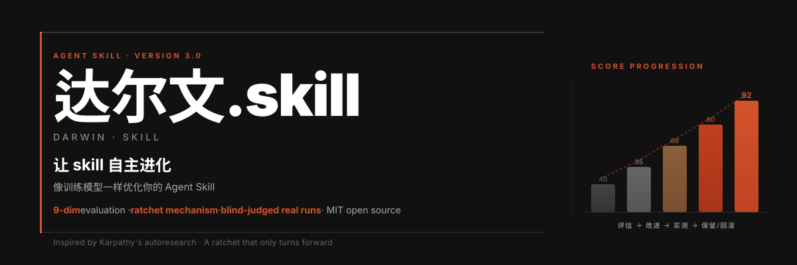
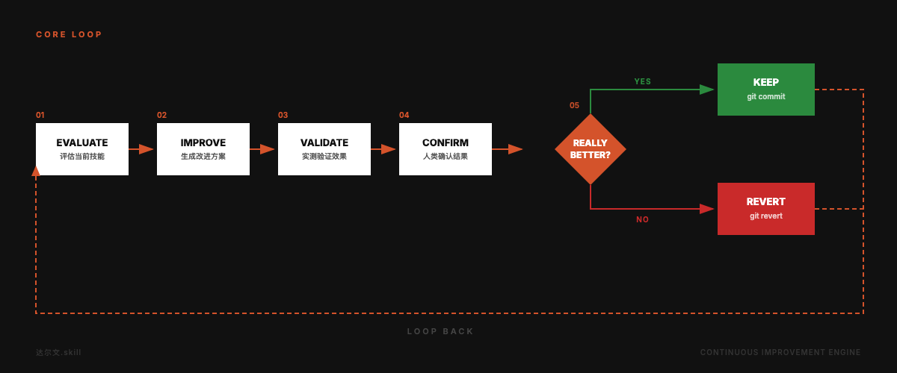
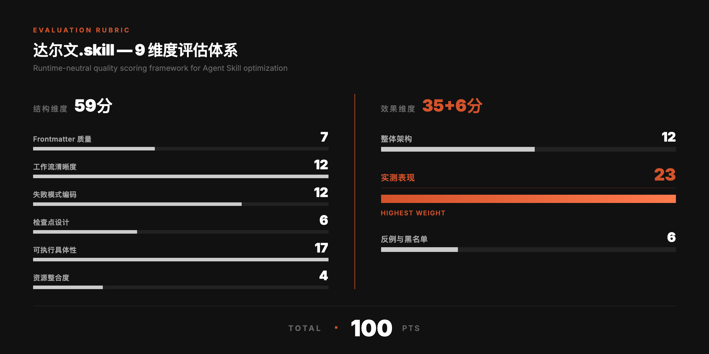
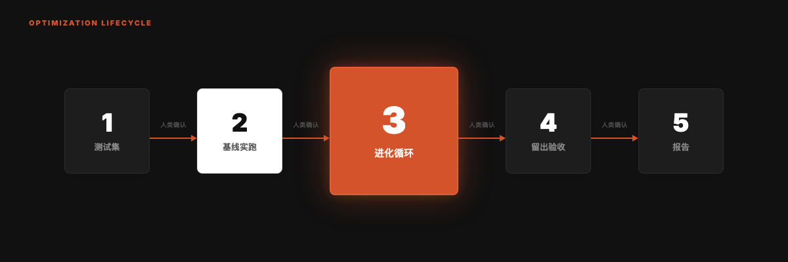

<div align="right">

**[English](README_EN.md)** | 中文

</div>



<p align="center">
  
  <br/>
  <sub>动画由 <a href="https://github.com/alchaincyf/huashu-design">huashu-design</a> skill 制作</sub>
</p>

<div align="center">

# 达尔文.skill 3.0

**像训练模型一样进化你的 Agent Skills。**

受 [Andrej Karpathy 的 autoresearch](https://github.com/karpathy/autoresearch) 启发，把自主实验循环从模型训练搬到 Skill 优化。一个只能向前转的棘轮。

**v3.0** · 2026-11 · 棘轮从「评委读文档投票」升级为「评委盲评实跑产出」。

[](LICENSE)
[](#30-改了什么)
[](https://skills.sh)
[](https://skills.sh)
[](https://github.com/microsoft/SkillOpt)

```
npx skills add alchaincyf/darwin-skill
```

</div>

---

> [!NOTE]
> **🤝 微软研究院把达尔文列进了 SkillOpt 的集成名单。**
> 2026-06-03，微软在 [SkillOpt 仓库](https://github.com/microsoft/SkillOpt) 的更新里写道：
> *「gbrain, gbrain-evals, and **darwin-skill** have all integrated SkillOpt.」*

---

## 3.0 改了什么

核心循环没变：评估 → 改进 → 实测验证 → 人类确认 → 保留或回滚。9 维 rubric、独立评委、git 回滚、每个 skill 后的人工检查点、成果卡片，都还在。

变的是棘轮量什么。2.x 让评委读改前改后两版 SKILL.md，投票决定留不留。2026 年的几项研究和我们自己的记录都说明，这把尺子量错了东西：

| 发现 | 来源 |
|:---|:---|
| 读文档打出的分数，和 skill 实跑带来的提升几乎不相关（相关系数 −0.02 和 −0.03） | NVIDIA，arXiv:2608.20614 |
| 按「看起来完整」选出来的文档，在行为指标上是全组最差 | JetBrains，arXiv:2609.12742 |
| 精简型 skill 带来 +19 个百分点，面面俱到型只有 +0.7；模型自己写的 skill 比不带还差 | SkillsBench，arXiv:2602.12670 |
| 评委 3 比 0 通过的改动，上真机多绕了 33 次工具调用 | 本项目 2026-09 的记录 |

所以 3.0 做了七件事：

1. **行为棘轮。** 每次改动后，独立 agent 带着新版 skill 真的去干活，评委盲评新旧两版的产出。读文档的 9 维评分降级为诊断工具，只用来找毛病和排先后。
2. **先问有没有用。** 进化之前先让带 skill 的 agent 和裸模型各跑一遍。裸模型已经会的，告诉你这个 skill 在这些任务上看不出价值；帮倒忙的，先删再说。
3. **平局归短的那版。** 严格更好才保留；打平时只有变短了才保留。每次「差不多就留着」都在让 skill 变长，而长了反而没用。
4. **留出集验收。** 测试分成开发集和留出集。改动只看开发集，最后用留出集查是不是在迎合测试。
5. **脚本裁决，不靠掂量。** A/B 顺序随机、去掉能看出来历的线索、计票、裁决，都由 `scripts/darwin.py` 按固定规则完成。评委提出可核实的事实性指控时，先验证，事实大于票数。
6. **零成本体检。** `darwin.py check` 不花 token 扫完全部 skill：路由写没写清、正文超没超 500 行、引用的文件在不在、有没有密钥和个人路径。
7. **诚实的报告。** 每个结论标明证据等级（E0 体检、E1 读评、E2 实跑、E3 真机），固定写出已验证、未验证、剩余风险。

---

## 核心循环



---

## 为什么做这个

Agent Skill 生态在快速扩张。当你有 10 个 Skills 时可以手动维护；有 60 个以上时，你需要一个系统。

传统的 Skill 审查看的是文档：格式对不对、步骤有没有编号、路径能不能访问。但一个格式完美的 Skill，跑出来可能并不比不装它更好。达尔文只认一个判据：装上这个 skill 之后，agent 干同一件活是不是真的更好。

---

## 从 autoresearch 到 Skill 进化

| autoresearch | 达尔文.skill | 为什么这样映射 |
|:---|:---|:---|
| `program.md` | 达尔文的 SKILL.md | 定义评估标准和约束规则 |
| `train.py` | 每个待进化的 SKILL.md | 被优化的资产，每轮只改它 |
| `val_bpb` | 盲评实跑产出的胜平负 | autoresearch 的 loss 重跑同数；LLM 评分不是，所以不比绝对分数，只做成对比较 |
| `git ratchet` | keep / revert | 只保留实跑证明更好的提交 |
| `test set` | test-prompts.json，分开发集和留出集 | 验证改进是真的，不是迎合测试 |
| 全自主运行 | **人在回路** | Skill 的好坏比 loss 微妙，关键节点要人判断 |

---

## 五条核心原则

| # | 原则 | 说明 |
|:---|:---|:---|
| 01 | **单一可编辑资产** | 每轮只验证一个假设，改进可归因 |
| 02 | **双重评估** | 读文档找毛病，跑任务定去留 |
| 03 | **棘轮机制** | 只保留实跑更好的改动，其余回滚 |
| 04 | **独立评分** | 执行者和评委都是独立子 agent，评委不知道哪份是新版 |
| 05 | **人在回路** | 测试集、基线、每个 skill 进化完，三处暂停等用户确认 |

---

## 9 维度评估体系

总分 100，权重和 2.x 一致。3.0 里它的用途是诊断和排序：总分决定先改谁，各维度得分指出毛病可能在哪。它不决定一次改动留不留。



两处调整：

- **实测表现（23 分）不再由评委凭感觉给**，按实跑结果换算：检查项通过率定基础分，对裸模型的增益封顶。没实跑就没有这项分数，总分标「缺实测，不可比」。
- **必要性原则。** 失败分支、检查点、黑名单只在任务确实脆弱的地方要求。为凑分硬加的章节按冗余扣分。

---

## 进化流程



| 阶段 | 做什么 | 人工检查点 |
|:---|:---|:---|
| 0 准备 | 体检、建分支、快照、读历史记录、确认不动区 | |
| 1 测试集 | 至少 4 条，开发集和留出集各半；优先用真实用过的请求 | 🔴 确认测试集 |
| 2 基线实跑 | 带 skill 和裸跑各一遍，盲评出增益；读评出 9 维分数 | 🔴 确认评分卡和方向 |
| 3 进化循环 | 每轮一个假设：先删、再改、再移、最后才加；实跑、三评委盲评、脚本裁决 | |
| 4 留出验收 | 原始版对最终版跑留出集；需要时测触发、上真机 | 🔴 人审 diff |
| 5 报告 | 结论、分数、实测、改动、已验证、未验证、剩余风险 | |

---

## 棘轮怎么裁决

`darwin.py tally` 按四条规则给出结论，主 agent 不参与掂量：

| 盲评结果 | 裁决 |
|:---|:---|
| 胜多于负，检查项没有倒退 | 保留 |
| 打平，新版更短 | 保留 |
| 打平，新版没变短 | 回滚 |
| 负多于胜，或检查项倒退 | 回滚 |

胜负只差一条且评委有分歧时，那几条两版各重跑一次再裁。回滚用 `git revert` 生成反向提交，历史不丢。

---

## 实测

2026-11-14，用 3.0 流程在 [huashu-excel](https://github.com/alchaincyf/huashu-excel)（数据分析 skill，正文 791 行）的副本上跑了一遍。两条开发集任务用的是它自带测试集里的真实请求，配上按原题陷阱合成的数据：一份两个工作表交界处有 235 笔重复订单的销售明细，一份承诺时限整列为空的工单表。执行者和评委都是独立子 agent（Claude Sonnet）。

| 步骤 | 结果 |
|:---|:---|
| 体检 | 0 错误，1 警告：正文超过 500 行 |
| 基线：带 skill 对裸模型 | 1 胜 1 平 0 负；检查项通过 7/7 对 6/7 |
| 第 1 轮假设 | 两条任务都不出报告文件，却要读完 253 行报告制作细节；把这部分下沉到 references |
| 第 1 轮裁决（3 位评委盲评） | 1 胜 1 平 0 负（胜出的两票都只是略好），检查项没有倒退，SKILL.md 体积 −31%，保留 |
| 每次执行的 token | 裸跑约 7.2 万，原版约 9.8 万，新版约 9.2 万 |

这次试跑的边界：只有 2 条开发集任务，测试数据是合成的；没有跑留出集，也没有验证「出报告」类任务在下沉之后是否受影响；改动只在副本上，没有合进 huashu-excel。按 3.0 的报告规则，这些都属于「未验证」。

试跑还抓出评测协议自己的三个漏洞，已在发布前修掉：测试文件放在 skill 目录里，执行者能读到检查项；执行记录和产出里的路径会让评委认出哪份带 skill；带检查点的 skill 会停下来等一个不存在的用户。

---

## 和 skill-creator 的评测有什么不同

Anthropic 的 skill-creator 已经有带 skill 对基线的实跑、检查项评分和盲评比较器。达尔文 3.0 在评测这一段多做了这些：

| | skill-creator | 达尔文 3.0 |
|:---|:---|:---|
| 盲评 | 可选的进阶项 | 每次裁决必做；随机 A/B 顺序，去掉执行记录和路径线索 |
| 保留还是回滚 | 人看结果后决定 | 脚本按固定规则裁决，再交人审 |
| 平局 | 无规则 | 平局归短的那版 |
| 留出集 | 只用于 description 优化 | 正文改动也要过留出集 |
| 事实性指控 | 无规则 | 先验证，事实大于票数 |
| 触发测试 | 只看目标 skill | 把邻居 skill 一起放进去测 |
| 改法偏好 | 无 | 先删后加，体积增长要有失败证据 |
| 模型升级后回归 | 无 | 复测模式 |
| 证据等级 | 无 | E0 到 E3，报告分列已验证与未验证 |
| 全量筛查 | 无 | 零 token 的体检脚本 |

skill-creator 还负责从零创建 skill、带结果查看器，那不是达尔文要做的事。两者可以配合：用它造，用达尔文进化。

---

## 快速开始

```bash
npx skills add alchaincyf/darwin-skill
```

安装后在任何支持 Skill 的 Agent 工具里说：

| 你说 | 它做 | 成本 |
|:---|:---|:---|
| 「给所有 skill 体检」 | 跑体检脚本，出排序表 | 约等于零 |
| 「评估 xx 这个 skill」 | 对裸模型实跑，出 9 维评分卡，不改文件 | 6 次左右子 agent |
| 「优化 xx 这个 skill」 | 完整进化流程 | 20 多次子 agent |
| 「复测 xx」 | 模型升级后用原测试集重跑 | 同评估 |

体检也可以直接在终端跑：

```bash
python3 scripts/darwin.py check ~/.claude/skills   # 换成你的 skills 目录
```

无法访问 GitHub 的朋友，可以直接下载 zip 包：[darwin-skill.zip](https://pub-161ae4b5ed0644c4a43b5c6412287e03.r2.dev/skills/darwin-skill.zip)，解压后把完整的 `darwin-skill` 文件夹放到当前 Agent/runtime 文档指定的 skills 目录中。请保留 `SKILL.md`、`references/`、`scripts/` 和 `templates/` 的相对结构；不要只复制 `SKILL.md`。

使用提示：

- 在 git 仓库里跑进化，并先把你本地对 skill 的改动 commit 或 stash，这样达尔文才能干净地保留或回滚实验改动。
- 实跑需要能派独立子 agent 的环境。不能派时，达尔文只做体检和读评，并在报告里标明缺实测。
- 测试任务不会自动执行对外动作（发布、推送、发消息）。这类测试会列进「未验证」，交给你决定。
- 每个 skill 进化完都会停下来给你看 diff，尤其当 skill 涉及 shell 命令、git 操作、凭证或发布流程时，请认真看。

---

## 已知的局限

- 每个 skill 只有几条测试，只能发现大差异。小改进会被运行波动淹没，在 3.0 里会被判平并回滚，这是有意的取舍。
- 评委仍是 LLM。成对比较和随机顺序能抵消一部分偏差，抵消不了全部。
- 触发测试是模拟的，和各 runtime 真实的加载逻辑有出入。

---

## References & Credits

每条规则对应的证据和数字见 [references/v3-evidence.md](references/v3-evidence.md)。

- **autoresearch**（Karpathy）：[github.com/karpathy/autoresearch](https://github.com/karpathy/autoresearch)。单一可编辑资产、实验循环、棘轮，达尔文 1.0 的原始灵感。
- **SkillOpt**（Microsoft Research 等，arXiv:[2605.23904](https://arxiv.org/abs/2605.23904)）：候选改动只有在留出的选择集上严格更好才接受，平局拒绝。代码 [github.com/microsoft/SkillOpt](https://github.com/microsoft/SkillOpt)。
- **arXiv:[2605.23899](https://arxiv.org/abs/2605.23899)**（复旦大学、Microsoft Research、上海交通大学，代号 SkillLens，正式标题 *From Raw Experience to Skill Consumption*）：失败模式编码、可执行具体性、高风险动作黑名单三个维度的实证来源。论文实测：LLM judge 盲选两份 skill 哪份更好，没有评分标准时准确率 46.4%，按这三个维度打分后 73.8%。另有一篇正标题就叫 SkillLens 的不同论文（2605.08386），引用请认编号。
- **SkillsBench**（arXiv:[2602.12670](https://arxiv.org/abs/2602.12670)）：精简的 skill 有用，面面俱到的没用。
- **ACES**（NVIDIA，arXiv:[2608.20614](https://arxiv.org/abs/2608.20614)）：读文档的分数预测不了实跑增益；带 skill 与不带的成对差值才是 skill 的价值。
- **Skill Issue**（JetBrains Research，arXiv:[2609.12742](https://arxiv.org/abs/2609.12742)）：给文档打分的指标会选出行为最差的文档；小测试集分辨不了几个百分点的差异。
- **SSO**（arXiv:[2607.28777](https://arxiv.org/abs/2607.28777)）：没有标准答案时，成对比较执行结果，随机呈现顺序。
- **138K SKILL.md 研究**（arXiv:[2608.08453](https://arxiv.org/abs/2608.08453)）：路由缺陷最常见，篇幅越长缺陷越多。
- 感谢提 issue 和 PR 的朋友。3.0 直接采纳了 #7（已验证、未验证、剩余风险）、#18（带真实数据的执行型测试）、#24（安全扫描观感）、#25（评估成本）和 #29（路径可移植）。

**达尔文和 SkillOpt 的区别**：SkillOpt 是全自主系统，需要带标准答案的任务集。达尔文面向手里只有几条真实请求的 skill 作者，用盲评代替标准答案，并在关键节点停下来让人判断。

---

## 关于作者

| | |
|:---|:---|
| 🌐 官网 | [bookai.top](https://bookai.top) · [huasheng.ai](https://www.huasheng.ai) |
| 𝕏 Twitter | [@AlchainHust](https://x.com/AlchainHust) |
| 📺 B站 | [花叔](https://space.bilibili.com/14097567) |
| ▶️ YouTube | [@Alchain](https://www.youtube.com/@Alchain) |
| 📕 小红书 | [花叔](https://www.xiaohongshu.com/user/profile/5abc6f17e8ac2b109179dfdf) |
| 💬 公众号 | 微信搜「花叔」 |

---

<p align="center"></p>

---

## 许可证

MIT

---

<div align="center">

**[女娲](https://github.com/alchaincyf/nuwa-skill)** 造 Skill。<br>
**达尔文** 让 Skill 进化。<br><br>
*只保留改进，时间就站在你这边。*

<br>

MIT License © [花叔 Huashu](https://github.com/alchaincyf)

</div>

---

<div align="center">
<sub>作者的其他项目 · also by 花叔</sub>

[](https://github.com/alchaincyf/fanbox)

</div>
