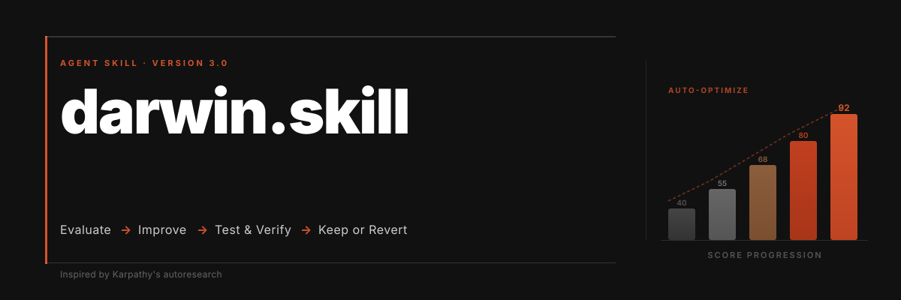
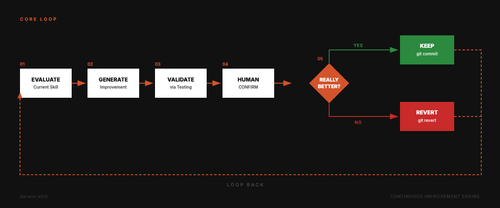
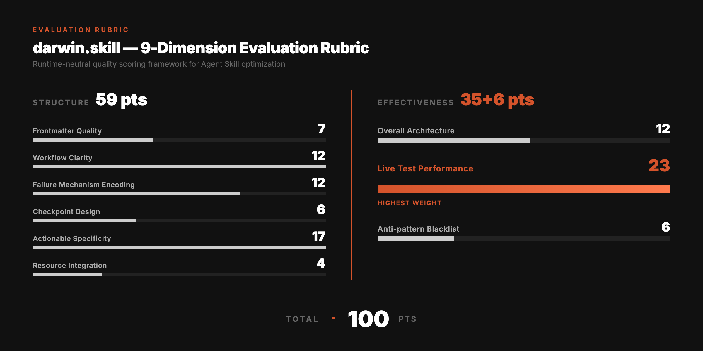
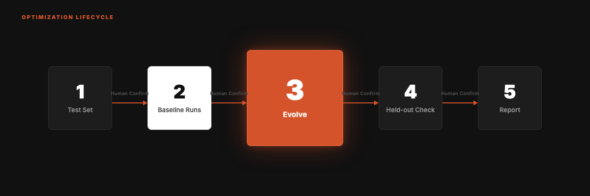

<div align="right">

English | **[中文](README.md)**

</div>



<div align="center">

# darwin.skill 3.0

**Evolve your Agent Skills the way you train models.**

Inspired by [Karpathy's autoresearch](https://github.com/karpathy/autoresearch). Autonomous experiment loops, applied to skills. A ratchet that only turns forward.

**v3.0** · 2026-11 · The ratchet now judges what a skill *does*, not how its document reads.

[](LICENSE)
[](#whats-new-in-30)
[](https://skills.sh)
[](https://skills.sh)
[](https://github.com/microsoft/SkillOpt)

```
npx skills add alchaincyf/darwin-skill
```

</div>

---

> [!NOTE]
> **🤝 Microsoft Research lists darwin-skill among SkillOpt's integrations.**
> On 2026-06-03, the [SkillOpt repo](https://github.com/microsoft/SkillOpt) noted:
> *"gbrain, gbrain-evals, and **darwin-skill** have all integrated SkillOpt."*

---

## What's New in 3.0

The core loop is unchanged: evaluate → improve → validate → human confirm → keep or revert. The 9-dimension rubric, independent judges, git rollback, a human checkpoint after every skill, and result cards are all still here.

What changed is what the ratchet measures. In 2.x, judges read the before and after SKILL.md and voted. Research published in 2026, and our own logs, show that this measures the wrong thing:

| Finding | Source |
|:---|:---|
| Scores from reading a skill document are essentially uncorrelated with the lift the skill gives a live agent (ρ = −0.02 and −0.03) | NVIDIA, arXiv:2608.20614 |
| The document selected for "looking complete" was the worst of its set on every behavioral metric | JetBrains, arXiv:2609.12742 |
| Compact skills add +19 points; comprehensive ones add +0.7; model-written skills do worse than no skill | SkillsBench, arXiv:2602.12670 |
| An edit that judges approved 3–0 cost 33 extra tool calls on a real device | This project's logs, 2026-09 |

So 3.0 does seven things:

1. **A behavior ratchet.** After each edit, independent agents do real tasks with the new skill, and judges blind-compare the outputs of the old and new versions. The document rubric is demoted to a diagnostic: it finds problems and sets priorities.
2. **Ask whether the skill helps at all.** Before evolving, an agent with the skill and a bare model each run the tests. If the bare model already does the job, darwin tells you so. If the skill hurts, it deletes before it adds.
3. **Ties go to the shorter version.** An edit is kept only when it is strictly better, or equal and shorter. Every "close enough, keep it" makes a skill longer, and longer skills stop helping.
4. **Held-out acceptance.** Tests are split into a dev set and a held-out set. Edits are driven by the dev set; the held-out set checks that they did not just fit the tests.
5. **A script decides, not a feeling.** Random A/B order, removal of anything that reveals which output is which, vote counting and the verdict are all done by `scripts/darwin.py` under fixed rules. When a judge raises a checkable factual objection, it is verified first: facts outrank votes.
6. **A zero-cost health check.** `darwin.py check` scans every skill without spending tokens: routing, body length, missing references, secrets, personal paths.
7. **Honest reports.** Every conclusion carries an evidence level (E0 check, E1 read, E2 run, E3 real environment), and every report lists what was verified, what was not, and the remaining risk.

---

## The Core Loop



---

## Why This Exists

With 10 skills you can maintain them by hand. With 60 or more you need a system.

Conventional skill review looks at the document: format, numbered steps, reachable paths. A perfectly formatted skill can still leave an agent no better off than having no skill. darwin accepts one criterion: with this skill installed, does the agent do the same job better?

---

## From autoresearch to Skill Evolution

| autoresearch | darwin.skill | Why this mapping |
|:---|:---|:---|
| `program.md` | darwin's SKILL.md | Defines the evaluation criteria and constraints |
| `train.py` | Each SKILL.md being evolved | The asset under optimization; one hypothesis per round |
| `val_bpb` | Win/tie/loss from blind comparison of real outputs | A loss is repeatable; an LLM score is not, so darwin compares pairs and never absolute scores |
| `git ratchet` | keep / revert | Only commits proven better by real runs survive |
| `test set` | test-prompts.json, split into dev and held-out | Confirms the gain is real, not test-fitting |
| Fully autonomous | **Human in the loop** | Skill quality is subtler than a loss value |

---

## Five Core Principles

| # | Principle | Description |
|:---|:---|:---|
| 01 | **Single editable asset** | One hypothesis per round, so gains are attributable |
| 02 | **Dual evaluation** | Read the document to find problems; run tasks to decide |
| 03 | **Ratchet** | Keep only edits that real runs prove better; revert the rest |
| 04 | **Independent scoring** | Executors and judges are separate subagents; judges never know which output is new |
| 05 | **Human in the loop** | Three pauses: the test set, the baseline, and after each skill |

---

## 9-Dimension Evaluation Rubric

100 points, same weights as 2.x. In 3.0 its job is diagnosis and triage: the total says which skill to fix first, the dimensions say where the problem probably is. It does not decide whether an edit stays.



Two adjustments:

- **Live performance (23 points) is computed, not guessed**: the check pass rate sets the base score and the lift over the bare model caps it. No real run, no score; the total is marked incomparable.
- **Necessity.** Failure branches, checkpoints and blacklists are required only where the task is fragile. Sections added to chase points are penalized as redundancy.

---

## The Evolution Cycle



| Phase | What happens | Human checkpoint |
|:---|:---|:---|
| 0 Prepare | Health check, branch, snapshot, read history, agree on protected sections | |
| 1 Test set | At least 4 tests, half dev and half held-out; real past requests first | 🔴 Confirm tests |
| 2 Baseline runs | With-skill and bare-model runs, blind-judged for lift; a read review for the 9-dim score | 🔴 Confirm scorecard and direction |
| 3 Evolve | One hypothesis per round: delete, then rewrite, then move, and only then add; real runs, three blind judges, scripted verdict | |
| 4 Held-out check | Original vs final on the held-out set; trigger test and real-environment run where needed | 🔴 Review the diff |
| 5 Report | Verdict, score, live results, edits, verified, not verified, remaining risk | |

---

## How the Ratchet Decides

`darwin.py tally` applies four rules. The main agent does not weigh in:

| Blind result | Verdict |
|:---|:---|
| More wins than losses, no check regressed | Keep |
| Tie, new version shorter | Keep |
| Tie, new version not shorter | Revert |
| More losses than wins, or a check regressed | Revert |

When the margin is one test and judges disagree, those tests are rerun for both versions before deciding. Reverts use `git revert`, so history is preserved.

---

## A Real Run

On 2026-11-14 the 3.0 process was run on a copy of [huashu-excel](https://github.com/alchaincyf/huashu-excel), a data-analysis skill with a 791-line body. The two dev tasks are real requests from its own test set, paired with data synthesized to carry the original traps: a sales workbook whose two sheets share 235 duplicated orders, and a ticket export whose SLA-deadline column is entirely empty. Executors and judges were independent subagents (Claude Sonnet).

| Step | Result |
|:---|:---|
| Health check | 0 errors, 1 warning: body over 500 lines |
| Baseline: with skill vs bare model | 1 win, 1 tie, 0 losses; checks passed 7/7 vs 6/7 |
| Round 1 hypothesis | Neither task produces a report file, yet both load 253 lines of report-making detail; move it to references |
| Round 1 verdict (3 blind judges) | 1 win, 1 tie, 0 losses (both deciding votes were "slight"), no check regressed, SKILL.md −31% in size: keep |
| Tokens per execution | Bare about 72k, original about 98k, new version about 92k |

The limits of this run: only 2 dev tasks, on synthetic data; the held-out set was not run, and report-producing tasks were not checked after the move; the edit lives on a copy and was not merged into huashu-excel. Under 3.0's reporting rules all of that is "not verified".

The run also exposed three holes in the evaluation protocol itself, fixed before release: test files sitting in the skill directory let executors read the checks; transcripts and paths in the outputs let judges tell which output had the skill; and a skill with checkpoints stops to wait for a user who is not there.

---

## How This Differs from skill-creator's Evals

Anthropic's skill-creator already runs with-skill against a baseline, grades assertions, and has a blind comparator. On the evaluation side, darwin 3.0 adds:

| | skill-creator | darwin 3.0 |
|:---|:---|:---|
| Blind comparison | Optional advanced step | Required for every verdict; random A/B order, transcripts and path clues removed |
| Keep or revert | A person decides after viewing results | A script applies fixed rules, then a person reviews |
| Ties | No rule | Ties go to the shorter version |
| Held-out set | Description optimization only | Body edits must pass it too |
| Factual objections | No rule | Verified first; facts outrank votes |
| Trigger test | Target skill alone | Neighboring skills included as competition |
| Edit preference | None | Delete before adding; growth needs failing evidence |
| Regression after a model upgrade | None | Retest mode |
| Evidence level | None | E0 to E3, with verified and not-verified listed separately |
| Fleet-wide screening | None | Zero-token health check |

skill-creator also creates skills from scratch and ships a results viewer, which darwin does not try to do. They work together: create with one, evolve with the other.

---

## Quick Start

```bash
npx skills add alchaincyf/darwin-skill
```

Then tell your agent:

| You say | It does | Cost |
|:---|:---|:---|
| "health-check all my skills" | Runs the check script, returns a ranked table | About zero |
| "evaluate skill X" | Real runs against the bare model, a 9-dim scorecard, no edits | About 6 subagent runs |
| "optimize skill X" | The full evolution cycle | 20-odd subagent runs |
| "retest X" | Reruns the saved tests after a model upgrade | Same as evaluate |

The health check also runs directly:

```bash
python3 scripts/darwin.py check ~/.claude/skills   # use your own skills directory
```

Can't access GitHub? Download the zip: [darwin-skill.zip](https://pub-161ae4b5ed0644c4a43b5c6412287e03.r2.dev/skills/darwin-skill.zip). Extract the complete `darwin-skill` folder into the skills directory documented by your agent/runtime. Keep `SKILL.md`, `references/`, `scripts/`, and `templates/` together; do not copy only `SKILL.md`.

Notes:

- Run evolution inside a git repository, and commit or stash your local edits to the skill first, so darwin can keep or revert its experiments cleanly.
- Real runs need an environment that can spawn independent subagents. Without one, darwin does only the health check and the read review, and says so in the report.
- Tests never perform outward actions (publish, push, send messages) on their own. Such tests are listed as not verified and left to you.
- darwin stops after each skill to show you the diff. Read it, especially when the skill involves shell commands, git, credentials or publishing.

---

## Known Limits

- A handful of tests per skill can only detect large differences. Small gains drown in run-to-run variance; in 3.0 they are judged a tie and reverted. That is a deliberate trade.
- Judges are still LLMs. Pairwise comparison and random order cancel some bias, not all.
- The trigger test is a simulation and differs from each runtime's real loading logic.

---

## References & Credits

The evidence and numbers behind each rule are in [references/v3-evidence.md](references/v3-evidence.md) (Chinese).

- **autoresearch** (Karpathy): [github.com/karpathy/autoresearch](https://github.com/karpathy/autoresearch). Single editable asset, experiment loop, ratchet; the original inspiration for darwin 1.0.
- **SkillOpt** (Microsoft Research et al., arXiv:[2605.23904](https://arxiv.org/abs/2605.23904)): a candidate edit is accepted only if strictly better on a held-out selection split; ties are rejected. Code: [github.com/microsoft/SkillOpt](https://github.com/microsoft/SkillOpt).
- **arXiv:[2605.23899](https://arxiv.org/abs/2605.23899)** (Fudan University, Microsoft Research, Shanghai Jiao Tong University; code alias SkillLens; title *From Raw Experience to Skill Consumption*): the empirical source for three rubric dimensions. An unguided LLM judge picking the better of two skills is 46.4% accurate; scoring on those three dimensions raises it to 73.8%. A different paper is actually titled SkillLens (2605.08386); cite the identifier.
- **SkillsBench** (arXiv:[2602.12670](https://arxiv.org/abs/2602.12670)): focused skills help, exhaustive ones do not.
- **ACES** (NVIDIA, arXiv:[2608.20614](https://arxiv.org/abs/2608.20614)): document scores do not predict live lift; the paired with/without difference is the skill's value.
- **Skill Issue** (JetBrains Research, arXiv:[2609.12742](https://arxiv.org/abs/2609.12742)): file-scoring metrics select the worst-behaving document; small test sets cannot resolve few-point gains.
- **SSO** (arXiv:[2607.28777](https://arxiv.org/abs/2607.28777)): without ground truth, compare executions pairwise and randomize presentation order.
- **138K SKILL.md study** (arXiv:[2608.08453](https://arxiv.org/abs/2608.08453)): routing defects are the most common, and defects grow with length.
- Thanks to everyone who filed issues and PRs. 3.0 directly adopts #7 (verified / not verified / residual risk), #18 (execution tests with real data), #24 (security-scan perception), #25 (evaluation cost) and #29 (portable paths).

**darwin vs SkillOpt**: SkillOpt is fully autonomous and needs a task set with ground truth. darwin is for skill authors who have a few real requests and no labels: it uses blind comparison in place of ground truth and stops for human judgment at key points.

---

## About the Author

| | |
|:---|:---|
| 🌐 Website | [bookai.top](https://bookai.top) · [huasheng.ai](https://www.huasheng.ai) |
| 𝕏 Twitter | [@AlchainHust](https://x.com/AlchainHust) |
| 📺 Bilibili | [花叔](https://space.bilibili.com/14097567) |
| ▶️ YouTube | [@Alchain](https://www.youtube.com/@Alchain) |
| 📕 Xiaohongshu | [花叔](https://www.xiaohongshu.com/user/profile/5abc6f17e8ac2b109179dfdf) |
| 💬 WeChat | Search "花叔" |

---

## License

MIT

---

<div align="center">

**[Nuwa](https://github.com/alchaincyf/nuwa-skill)** creates skills.<br>
**Darwin** makes them evolve.<br><br>
*Keep only improvements. Time is on your side.*

<br>

MIT License © [花叔 Huashu](https://github.com/alchaincyf)

</div>
